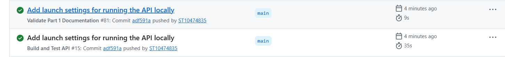
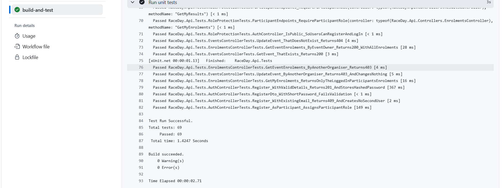

# RaceDay API (Part 2)

## About
This is the RESTful API behind the RaceDay event management system for the South African road running, walking and cycling community. It follows the endpoint plan in `docs/RaceDay_API_Endpoint_Plan.pdf`, and its database matches the Part 1 ERD (`docs/RaceDay_ERD.png`) and SQL script (`docs/RaceDay_Database_Script.sql`).

Built with ASP.NET Core 8 Web API (C#), Entity Framework Core 8 (Code-First), SQL Server, session-based authentication, Swagger, xUnit unit tests and GitHub Actions.

## System roles
**Organiser**
- Registers an account as an Organiser
- Creates, edits and deletes their own events
- Defines age and distance categories for their own events
- Views all enrolments for their own events
- Captures finish times and finishing positions for participants in their own events

**Participant**
- Registers an account as a Participant
- Browses events and their categories
- Enters an event by selecting a category
- Views their own enrolments
- Views their own results

Both roles can view and update their own profile. Role-based access is enforced at the API level: a request with no session returns **401 Unauthorized**, and a request with the wrong role (or for another organiser's event) returns **403 Forbidden**.

## Project structure
```
RaceDay-POE/
  docs/                      Part 1 planning documents (ERD, endpoint plan, SQL script)
  .github/workflows/         CI workflows (validate-docs.yml, build-and-test.yml)
  Part2-API/
    Controllers/             Auth, Users, Events, Categories, Enrolments, Results
    Data/                    AppDbContext (EF Core configuration and constraints)
    Dtos/                    Request models with validation rules
    Filters/                 SessionAuthorize attribute (login and role checks)
    Helpers/                 Session helper methods
    Migrations/              EF Core migrations that create the database
    Models/                  Role, User, Event, Category, Enrolment, Result
    RaceDay.Api.Tests/       xUnit unit tests
    Program.cs               Application startup (database, session, Swagger)
    appsettings.json         Connection string
```

## Prerequisites
- Visual Studio 2022 with the ASP.NET and web development workload (or the .NET 8 SDK)
- SQL Server (for example SQL Server Express) and SQL Server Management Studio

## Setup and run
1. **Clone the repository**
```
   git clone https://github.com/ST10474835/RaceDay-POE.git
```
2. **Set your SQL Server name.** Open `Part2-API/appsettings.json` and change `Server=` in the connection string to your own SQL Server instance (for example `.\\SQLEXPRESS`). Keep the double backslash.
```
   "DefaultConnection": "Server=YOUR_SERVER\\SQLEXPRESS;Database=RaceDayDB;Trusted_Connection=True;TrustServerCertificate=True;"
```
3. **Create the database.** Use either option. The migration creates `RaceDayDB`, all six tables and the two seeded roles (Organiser and Participant).
   - Visual Studio: open `Part2-API/RaceDay.Api.csproj`, then **View > Other Windows > Package Manager Console** and run `Update-Database`.
   - Command line:
```
     dotnet tool install --global dotnet-ef
     dotnet ef database update --project Part2-API
```
   Do not also run the Part 1 SQL script against the same database. It creates the same schema for the planning stage, so use one or the other.
4. **Run the API.**
   - Visual Studio: select the `http` profile and press F5.
   - Command line:
```
     dotnet run --project Part2-API --launch-profile http
```
5. **Open Swagger.** Go to the address shown in the console with `/swagger` on the end (for example `http://localhost:5218/swagger`).
6. **Try the API in Swagger.**
   1. `POST /api/auth/register` to create an Organiser (`"role": "Organiser"`) and a Participant (`"role": "Participant"`).
   2. `POST /api/auth/login` with the email and password. Swagger sends the session cookie automatically, so you stay logged in.
   3. Call the endpoints for that role. Logging in as someone else switches the session. Restarting the API clears all sessions.

## Running the unit tests
```
dotnet test Part2-API/RaceDay.Api.Tests/RaceDay.Api.Tests.csproj
```
Or in Visual Studio: **Test > Test Explorer > Run All Tests**. The tests use an in-memory database, so SQL Server is not needed. There are 69 tests covering registration and login, event management, category management, enrolments, results, and role enforcement (401 and 403) on every endpoint.

## Authentication and role-based access
- Passwords are hashed with BCrypt and never stored in plain text.
- On login the API stores the user's ID and role in a server-side session (cookie-based).
- A `SessionAuthorize` attribute protects every endpoint except register and login. `[SessionAuthorize]` requires a login, and `[SessionAuthorize("Organiser")]` or `[SessionAuthorize("Participant")]` also requires that role.
- Organisers can only change or view enrolments and results for events they created.

## API endpoints
The full plan is in `docs/RaceDay_API_Endpoint_Plan.pdf`. All 17 endpoints are implemented and visible in Swagger.

| Method | Route | Role |
|---|---|---|
| POST | `/api/auth/register` | Public |
| POST | `/api/auth/login` | Public |
| POST | `/api/auth/logout` | Any logged-in user |
| GET | `/api/users/profile` | Any logged-in user |
| PUT | `/api/users/profile` | Any logged-in user |
| GET | `/api/events` | Any logged-in user |
| GET | `/api/events/{id}` | Any logged-in user |
| POST | `/api/events` | Organiser |
| PUT | `/api/events/{id}` | Organiser (owner of the event) |
| DELETE | `/api/events/{id}` | Organiser (owner of the event) |
| GET | `/api/events/{eventId}/categories` | Any logged-in user |
| POST | `/api/events/{eventId}/categories` | Organiser (owner of the event) |
| POST | `/api/enrolments` | Participant |
| GET | `/api/enrolments/mine` | Participant |
| GET | `/api/events/{eventId}/enrolments` | Organiser (owner of the event) |
| POST | `/api/results` | Organiser (owner of the event) |
| GET | `/api/results/mine` | Participant |

## CI/CD
GitHub Actions builds the API and runs all unit tests on every push (`.github/workflows/build-and-test.yml`).

**Successful build:**



**Unit tests passing in CI:**



## Video walkthrough
[Part 2 Video Walkthrough][(https://youtu.be/iHqbcrs6nQ0)]

## Differences between the plan, the database and the code
- Constraint and index names are generated by EF Core (for example `FK_Users_Roles_RoleID` and `IX_Enrolments_ParticipantID_CategoryID`) instead of the names used in the Part 1 script. Tables, columns, data types, keys, unique rules, CHECK constraints and defaults are the same.
- EF Core adds one extra table, `__EFMigrationsHistory`, to track migrations.
- The migrations seed only the two roles. The sample data from the Part 1 script is not loaded, and test accounts are created through the API.
- `GET /api/enrolments/mine` and `GET /api/results/mine` return 403 to an Organiser, because the plan lists them as Participant-only endpoints.
- Deleting an event also deletes its categories, enrolments and results in one transaction. The foreign keys use NO ACTION (as in the Part 1 script), so the API performs the clean-up itself.
- As in the plan, users choose their own role when registering. In a production system, Organiser accounts would normally be approved or invited.

## Part 2: RESTful API
The ASP.NET Core Web API, its unit tests and its CI workflow are in the [`Part2-API`](Part2-API) folder. See [`Part2-API/README.md`](Part2-API/README.md) for setup and run instructions, the role descriptions, the CI/CD screenshots and the video link.

[](https://github.com/ST10474835/RaceDay-POE/actions/workflows/build-and-test.yml)


